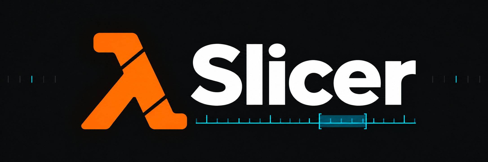

# Lambda Slicer

Desktop tool for slicing Half-Life: Adrenaline Gamer (GoldSrc) demos and finding weapon use in
them. The full design is in [IMPLEMENTATION_PLAN.md](IMPLEMENTATION_PLAN.md).

## Status

| Milestone | State |
|---|---|
| M0 scaffold | done: workspace, CLI, fixture manifest, docs, CI |
| M1 container + S0 controls | done; S0 passed in game ([engine-validation](docs/engine-validation.md)) |
| M2 network state decoder | decodes the whole corpus; delta bases are proven or flagged as inferred ([protocol profile](docs/protocol-profile-5-48.md)) |
| M3 arbitrary-start slicing | done; S1 restarts passed in game ([engine-validation](docs/engine-validation.md)) |
| M4 weapon analysis | done: actions, actors, kills, highlights ([analysis profile](docs/analysis-profile.md)) |
| M5 library and cache | done: scan and query over a SQLite cache ([library](docs/library.md)) |
| M6 desktop app | done: library, demo timeline and event table, clips, no-clobber export, fourteen languages ([app](docs/gui.md), [languages](docs/i18n.md), [right-to-left text](docs/gui-text.md)); gaps in [deferred](docs/deferred.md) |
| M7 release | engine matrix passed in game (multiplayer, singleplayer across level changes, spectator), restarts in any session, CI for Windows and Linux, portable Windows zip, MIT OR Apache-2.0; CI passes on GitHub; the GUI smoke test and native translation reviews remain ([release](docs/release.md)) |
| M8 viewer foundation | done: references audited, asset resolution against the installed game (`lambda-slicer-assets`, [viewer profile](docs/viewer-profile.md)); `wgpu` kept after a spike drawing a map and an animated model in the demo view, measured against Xenoxide in game (`lambda-slicer-render`, [viewer backend](docs/viewer-backend.md)); playback with one controller and clock, scene and sound state, and seeks from checkpoints that match sequential playback (`lambda-slicer-playback`) |
| M9 world and models | drawn, compared with the game on three clips: the demo view plays the demo from the recorder's view, the map with its brush entities, light styles, animated textures, water and sky, and every entity with a studio model, interpolated as the client draws it, players with their legs, aim and held weapons, lit from the map, the first-person weapon, sprite entities and team colours, with play, pause and a time bar ([viewer profile](docs/viewer-profile.md), "Viewer"); the camera, map and models match the game, and the sky and the viewmodel differ ([viewer validation](docs/viewer-validation.md)) |
| M10 effects and sound | done, compared with the game only by eye in the M9 clips: the game's sounds read and mixed from playback's channels with the engine's eight dynamic channels, and played on the default output device in step with the playhead, weapon events' sounds and weapon animations, the client events in model animations, reload sounds and muzzle flashes, ejected shells bouncing through the map, the server's sprite effects, explosions, smoke, blood, sparks and ricochets, its decals laid on the map, the clients' own bullet impacts, trails, beams and tracers, and the gauss's and the local Egon's beams (`lambda-slicer-audio`, [viewer profile](docs/viewer-profile.md), "Sound", "Sound output", "Client events", "Temporary entities", "Decals", "Bullet impacts", "Beams and tracers", "Gauss and Egon" and "Seeking with effects"); everything comes back the same after a seek, checked on six demos |

`cargo run --release -p lambda-slicer-gui` starts the app ([app](docs/gui.md)). Add `-- --locale ar`
to try a language, and demos or folders to open them for one session. `.\scripts\package.ps1`
builds the portable Windows zip in `dist`.

## CLI

```powershell
cargo build --release
.\target\release\lambda-slicer.exe inspect  'path\to\demo.dem'            # add --json - for JSON
.\target\release\lambda-slicer.exe validate 'path\to\demo.dem'            # non-zero exit on errors
.\target\release\lambda-slicer.exe control exact-copy   SRC --output OUT.dem
.\target\release\lambda-slicer.exe control roundtrip    SRC --output OUT.dem
.\target\release\lambda-slicer.exe control truncate-end SRC --end 4:48 --output OUT.dem
.\target\release\lambda-slicer.exe slice SRC --start 1:36 --end 4:48 --output OUT.dem   # S1 restart, any session
.\target\release\lambda-slicer.exe decode   'path\to\demo.dem'            # --events, --trace FROM TO, --json -
.\target\release\lambda-slicer.exe analyze  'path\to\demo.dem'            # weapon actions and actors, --occurrences, --json -
.\target\release\lambda-slicer.exe crosscheck 'path\to\demo.dem'          # exit 0 verified, 1 failed, 2 inconclusive
.\target\release\lambda-slicer.exe analyze  'path\to\demo.dem' --kills --weapon crossbow --victim-airborne
.\target\release\lambda-slicer.exe scan 'path\to\demos' --workers 4   # fill the library cache, Ctrl-C keeps finished files
.\target\release\lambda-slicer.exe query --kill-weapon crossbow --victim-airborne
.\target\release\lambda-slicer.exe query --min-spectating 0.5          # demos recorded mostly as a spectator
.\target\release\lambda-slicer.exe query --windows --limit 20           # best action windows in the library
.\target\release\lambda-slicer.exe hash FILES...
.\target\release\lambda-slicer.exe fixtures --manifest local-fixtures.json
```

With `--json -` stdout carries only the JSON document, and errors go to stderr. The text listings
from `--events` and `--trace` therefore need `--json FILE`.

Times accept `96`, `1:36`, or `00:01:36.250`. Exports never overwrite an existing file, never
modify the source, and work from a private snapshot of it. The reported source hash is computed
while that snapshot is copied, so it covers exactly the bytes the export read, and a source that
changes during the copy aborts the export.

## Development

```powershell
.\scripts\check.ps1            # formatting, clippy, tests and a release build, as CI runs them
.\scripts\check.ps1 -Linux     # the same again in WSL
# optional, needs local demos (see docs/fixture-recording.md):
$env:LAMBDA_SLICER_FIXTURE_MANIFEST = "$PWD\local-fixtures.json"
cargo test -p lambda-slicer-core --test local_corpus -- --ignored
# read-only surveys; a full corpus pass takes 20-35 minutes, so normally run them on a sample:
# build a 2000-demo sample (known problem files plus a seeded spread across maps)
cargo run --release -p lambda-slicer-core --example make_sample -- work\problem-demos.txt work\sample-2000.txt 2000 20261015 'F:\HLScreeniesDemos' 'F:\SteamLibrary\steamapps\common\Half-Life\ag'
cargo run --release -p lambda-slicer-core --example corpus_scan -- --list work\sample-2000.txt
cargo run --release -p lambda-slicer-core --example decode_scan -- --list work\sample-2000.txt
cargo run --release -p lambda-slicer-core --example crosscheck_scan -- --list work\sample-2000.txt
```

`work\problem-demos.txt` lists demos earlier scans flagged, one path per line; it and the sample
stay out of Git because they contain local paths.

Original demos are never committed (`*.dem` is ignored).

## License

Lambda Slicer is licensed under either of [MIT](LICENSE-MIT) or [Apache-2.0](LICENSE-APACHE), at
your option. Shipped dependencies and their licenses are listed in the release zip's
`THIRD-PARTY-NOTICES.txt` ([release](docs/release.md)).
