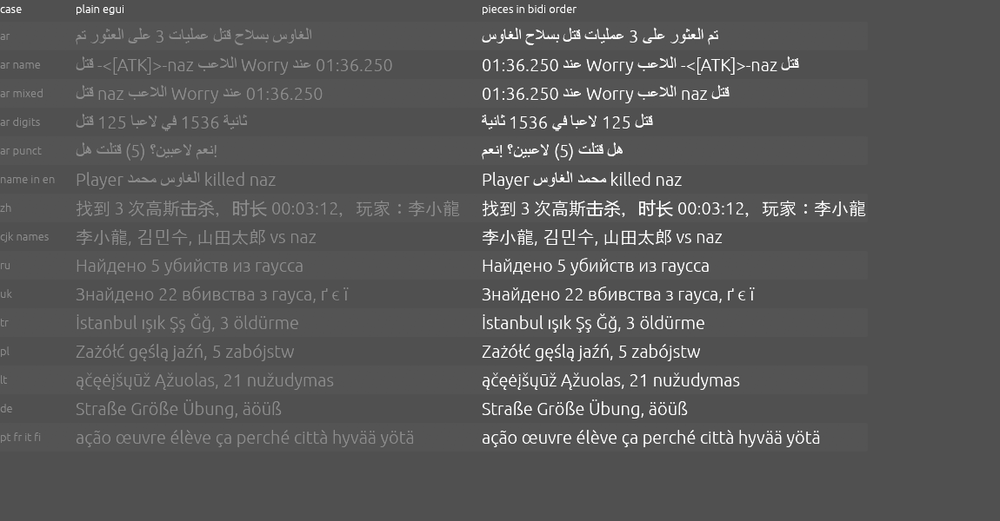

# GUI text rendering

Findings of the M6 text spike (`crates/lambda-slicer-gui/examples/text_spike.rs`), run on Windows 10
with eframe and egui 0.37.0 on 2026-10-16. The screenshot is `images/text-spike.png`.

## What egui 0.37 does

- **Shaping.** Each font run is shaped with harfrust, a port of HarfBuzz, so Arabic letters
  join correctly within a word and CJK text breaks lines by the East Asian rules.
- **Fonts.** eframe's default `system_fonts` feature discovers system fonts for characters the
  bundled fonts lack. Chinese, Japanese and Korean player names and the Chinese interface render
  with no bundled CJK font. The bundled fonts cover every Latin and Cyrillic letter of the
  fourteen languages.
- **No bidi.** egui splits the whole text into runs by font face, ignoring layout sections, and
  places the runs left to right in logical order. Bidi controls such as the isolates Fluent puts
  around arguments are dropped as invisible. So a multi-word Arabic line, or Arabic mixed with
  Latin names and times, comes out in the wrong order, as the plain column shows.
- **Reordering inside one layout fails.** Passing words in visual order as separate sections of
  one layout does not help, because egui merges the sections back into one run and harfrust
  reverses it again.

## Approach

Text containing right-to-left characters goes through a small bidi layer in the GUI crate.

1. The Unicode bidi algorithm (`unicode-bidi`) resolves the levels with the interface's base
   direction, right to left for Arabic and left to right otherwise.
2. Each line is split into level runs in visual order. Right-to-left runs are split at spaces with
   their words reversed and their brackets mirrored. Bidi controls are removed after they have set
   the order.
3. Each piece is laid out on its own, so egui only shapes one word of one direction, and the
   pieces are placed left to right.
4. Wrapping breaks lines in logical order by measured piece widths first, then orders each line.

Text without right-to-left characters keeps egui's own layout. The spike's right column shows the
result: Arabic sentences, Arabic with Latin names and times, multi-digit numbers, punctuation and
brackets, and an Arabic name inside English all come out in bidi order.

## Open

- **Text input.** egui's text fields edit and show text in logical order, so Arabic typed into a
  search box shows its words reversed while typing, and the cursor moves in logical order.
  Matching is unaffected. Fields that hold Arabic are only search and clip names, so this is a
  known limitation until egui gains bidi editing or a field draws its content through the bidi
  layer when not focused.
- **Review.** The ordering follows the bidi algorithm by construction, and single words are shaped
  by harfrust. An Arabic reader still needs to check the screens before Arabic counts as supported.
