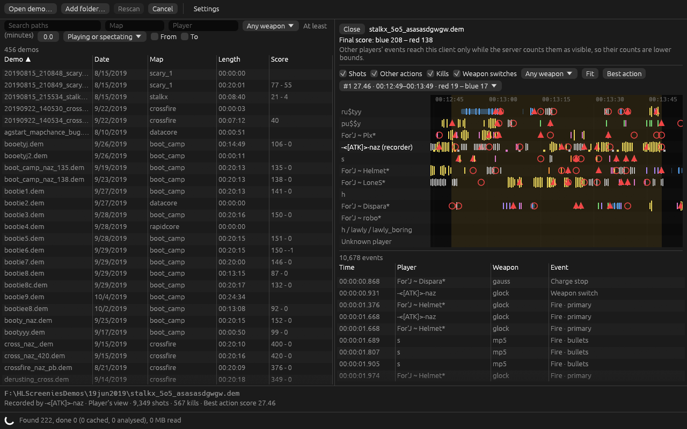
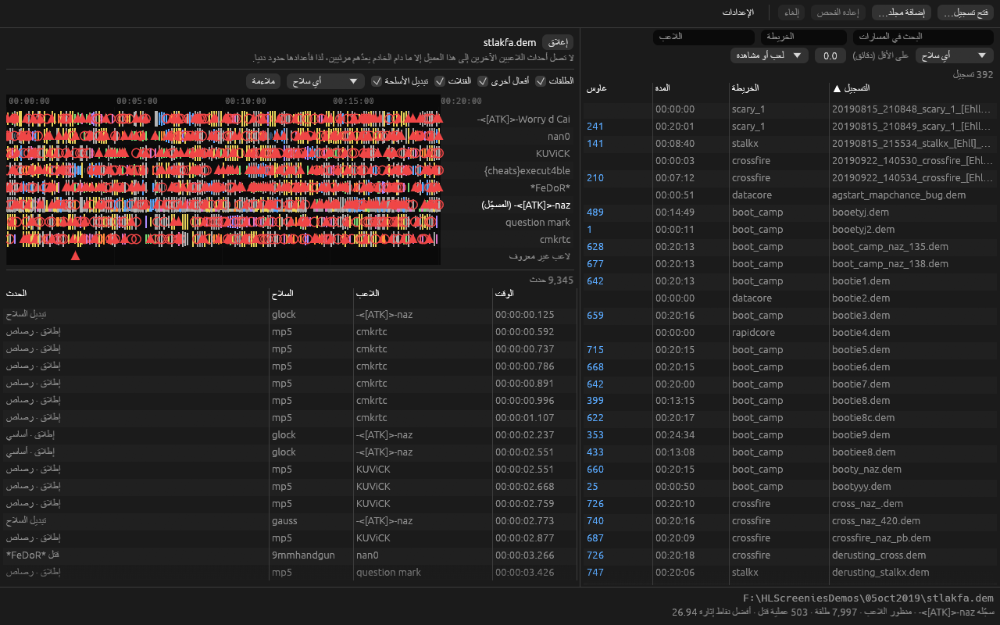

# Desktop app

`cargo run --release -p lambda-slicer-gui` starts the app. Demos and folders given on the command
line are opened for that session, `--locale TAG` picks a language for the run, `--cache FILE`
uses another library cache and `--clips FILE` another clips file. `--demo FILE --screenshot OUT.png`
opens a cached demo, waits for its analysis and saves the window, for checking a screen in any
language, and `--pseudo` lengthens every message to find text that does not fit
([languages](i18n.md)).

## Library

The left side lists the library cache ([library](library.md)): status, name, recording date, map,
length, final score, gauss shots, kills, the recording player's headshot kills and accuracy, best
action score and spectating share, newest first. Right-clicking any
heading chooses the columns, which are kept in the settings. Gauss shots, the number of primary and
charged gauss shots the recording saw from every player, start hidden. Beside an open demo only
name, date, map, length, score and gauss shots show. Rows load a page
at a time. Open demo, Add folder and dropping files or folders add to the library and scan in the
background. Dropped files are checked by their header, and anything else is named as not a demo.
The status bar shows the scan's progress, and its problem list says in the chosen language why a
file failed.

## Demo view

Selecting a demo analyses it again on its own thread, since shots are not kept in the cache, and
opens it beside a narrower library. Choosing another demo cancels that analysis. A demo opened with
Open demo, dropped on the window or named on the command line shows at once in the same way, and
joins the library when the scan stores it, so a missing or broken cache never stops a single demo
from opening (implementation plan §2.3). Library rows open their file from the path bytes the cache
keeps, not the display text, so names that are not valid Unicode open too.

- **Timeline.** Hidden at first, as it takes some reading. Show timeline opens it with a legend of
  the marks and a line on how to move around, and the choice is kept for later demos and runs. The
  scores, filters, golden minute and event table work with it hidden.
- **Lanes.** One per player connection, a reused slot being a new lane, with every name the player
  used and AG colour codes left out. The recorder's lane is marked. Actors that could not be
  resolved share one lane, last.
- **Marks.** Shots are ticks in the weapon's colour, other recorded actions grey ticks, kills red
  triangles in the killer's lane and deaths red circles in the victim's, and the recorder's weapon
  switches small squares. Gauss charges and egon beams are bars from start to end.
- **Wide zoom.** Marks closer than three pixels are drawn as one per kind, taller for more.
- **Moving.** The mouse wheel zooms around the pointer, dragging pans, double-click or Fit shows
  the whole demo, from the playback entry's start to its last frame. The time axis runs left to right in every language.
- **Selecting.** Hovering a mark shows its time, player and action at once. Clicking selects it, draws a
  line through the lanes and scrolls the event table to it. Clicking a table row selects its event
  and brings it into view.
- **Filters.** Shots, other actions, kills and weapon switches can be shown, only kills at
  first, and one weapon chosen, for both the lanes and the table.
- **Golden minute.** The button jumps to the minute with the highest action score, shown as
  intensity ([analysis profile](analysis-profile.md)), and the list beside it offers the best five
  with their score, time and frags per side, under Most intense moments. The chosen minute is
  shaded on the lanes, its events
  are tinted the same in the table, and the table scrolls to the first of them.
- **Scores.** Between the filters and the lanes, one column per team with its total and each
  player's frags and deaths, two columns for a duel, and a ranked list for three or more players
  without teams. It shows the final scores, as they stood at the last kill, until an event is
  selected in the lanes or the table, then the scores at that moment. Players who left drop out,
  as on the game's own scoreboard, and a team's `TeamScore` overrides its players' sum. HS counts
  headshot kills and Acc. the share of shots that hit, for the recording player only, as other
  players' often happen out of the recording's view. In a duel the opponent's headshots show too
  ([analysis profile](analysis-profile.md)). Hovering HS or Acc. here, the library's Headshots and
  Accuracy headings, or their filters explains how each is worked out. Show final
  scores goes back. The last kill decides the result because players often leave between the end
  of a game and the end of the recording. When the teams' columns do not fit side by side, they
  stand one above the other.
- **Event table.** Every event in time order with its time, the player's name at that moment, the
  weapon (the death notice's weapon string for kills) and what happened.

## Clips

A clip is a named range of a demo to export (implementation plan §8). Clips sit between the scores
and the lanes and are kept per demo in `clips.json` beside the settings. A clips file that is not
valid is renamed to `clips.json.unreadable-<seconds>` and the clips start empty, and one that cannot
be read stops saving for the session, so a stored clip is never written over. Both, and a save
that fails, show as a notice in the status bar until dismissed.

- **Adding.** New clip adds ten seconds from the start of the visible timeline, or from the
  recording's start, to edit by hand, which also serves demos with no events at all. Selecting an
  event proposes a range around it, shown as dashed lines on the lanes and named on the button,
  which adds it. Settings hold how many seconds it keeps before and after the
  event, 5 and 3 at first. With one of the most intense moments chosen, a second button clips that
  minute with the same padding. New clips are named Clip 1, Clip 2 and so on.
- **Editing.** Each clip has its name, start and end. Times are typed as `96`, `1:36` or
  `00:01:36.250`, with a point or a comma before the fraction, and show as `HH:MM:SS.mmm`. Text that
  is not a time is outlined in red and the clip keeps its old time. On the lanes a clip is a light
  blue band with its name, and dragging either edge moves it to whole milliseconds. Show brings a
  clip into view and Remove deletes it.
- **What the export cuts.** Below each clip are its length and the range an export would really
  cut. An export starts at the first frame group at or after the start and ends before the first
  at or after the end, so the requested 01:36 to 04:48 of `stalkx_5o5_asasasdgwgw.dem`, 03:12 long,
  cuts 00:01:36.009 to 00:04:48.000. The range comes from the frame groups the analysis records
  (`slice::range`), which follow the slicer's own rules and match its effective range on the
  synthetic restart tests and on that demo. Ranges an export would refuse without decoding say why
  in orange: an end past the recording, a range with nothing in it, a start on the very first
  frame, in a later session or with a new session inside it. Refusals that need the decoded state
  come from the export itself.
- **Sessions.** A level or map change starts a new session. A clip can start in any session once
  its map has loaded. Where a session's times repeat an earlier one's, a clip's start would land
  in the earlier session, so the app offers no clip there.

## Export

Export on a clip, or Export all clips, writes clips as demos that play on their own with the core's
restart export ([engine validation](engine-validation.md)), one after another on a thread of their
own. Clips an export would refuse are left out and their buttons are off.

- **Where.** Beside the demo, or in the export folder chosen in Settings. The line above the clips
  names the folder. Files are named as the plan suggests, for example
  `stalkx_5o5_asasasdgwgw__01m36s000-04m48s000.dem`, with only ASCII letters, digits, `-`, `_` and
  `.` from the demo's name, since the game's console splits a command at spaces. A taken name gets `_2`, `_3` and so on (`slice::naming`).
- **Safety.** Nothing is ever replaced. The export writes a temporary file beside the destination,
  validates it and publishes it under its final name only if no file took that name meanwhile, and
  the clip says Saved only after that. A failure leaves no file and says why in orange, for example
  a folder that does not exist.
- **Progress.** The clip under way shows a spinner and the rest wait. Stop exporting skips the
  clips not yet started, as the clip under way runs to its end. Closing the demo stops an export
  the same way.
- **Result.** The saved path and how many of the clip's snapshots were checked against the
  original. Inside a mod folder, the nearest folder above with a `liblist.gam`, the console command
  that plays it, such as `playdemo clips/stalkx_5o5_asasasdgwgw__01m36s000-04m48s000`, with a Copy
  button. Elsewhere the clip says to copy the file into the mod folder first. The CLI's `slice` and
  `control` print the same command.

`--export DIR` with `--demo` exports every clip of that demo into `DIR` once it is analysed, and a
screenshot run waits for it. On `stalkx_5o5_asasasdgwgw.dem` this gave files byte for byte the same
as `lambda-slicer slice` with the same range.

In Arabic the library moves to the right, lane labels sit right of the lanes, and the table's
columns run right to left.

## Measured (2026-10-16)

`stlakfa.dem`, a 20 minute 5 against 5 match with 7,997 shots and 503 kills, opens with its
analysis in under 3 s on the development machine and gives nine lanes and 9,345 events.
