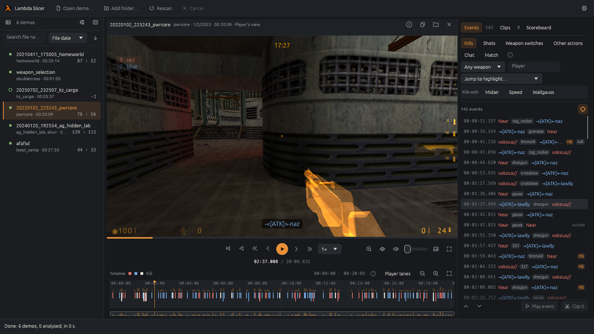
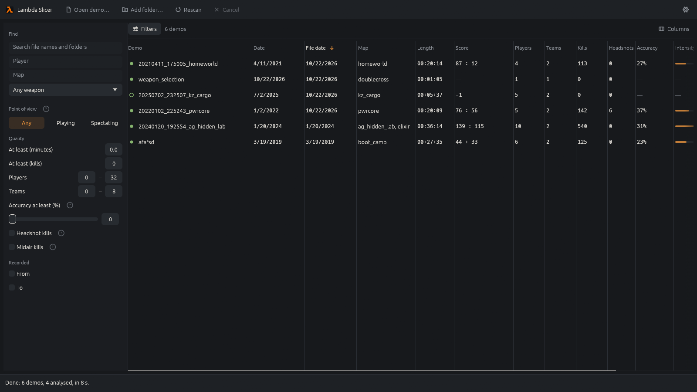

# The app

How Lambda Slicer's window works, in more detail than the [README](../README.md). The demo player's
inner workings are in [how the demo player works](viewer-profile.md).

## Starting it

`lambda-slicer-gui` takes demos and folders on the command line and opens them for that session.
Other options are for testing, and the full list is at the top of
`crates/lambda-slicer-gui/src/main.rs`:

- `--locale TAG` picks a language for the run, and `--pseudo` lengthens every message to find text
  that doesn't fit ([languages](i18n.md)).
- `--cache FILE` and `--clips FILE` use another library and clips file, and `--game DIR` another
  Half-Life folder.
- `--demo FILE --screenshot OUT.png` opens a demo from the library, waits for its analysis and
  saves the window. `--viewer-at SECONDS`, `--viewer-fullscreen`, `--tab` and `--settings` choose
  what it shows.
- `--demo FILE --export DIR` exports every clip of that demo into `DIR`.
- `--matches` starts on the library's Matches tab, `--favourites` with the favourites alone and
  `--hidden` with the hidden demos alone.
- `--viewer-free-at X,Y,Z,PITCH,YAW` starts the free camera at that place looking that way, the
  numbers Show position and view angles puts over the picture, to see someone's view again.
- `--viewer-follow N` watches through the eyes of the map's `N`th best player, as the number keys
  do, once the demo's players are known.

## Library

The toolbar has Open demo, Add folder, Rescan, Cancel and Settings. Until the first demo or folder
is added, Open demo and Add folder pulse. Folders are scanned in the background, subfolders
included, and the status bar shows the progress. Its problem list says why a file couldn't be
read. Dropped files are checked by their header, and anything else is named as not a demo.

The table lists the [library](library.md): status, name, recording date, file date, map, length,
final score, players, teams, kills, gauss shots, the recorder's headshots, the best multikill and
the longest killing spree by anyone, the recorder's accuracy, intensity and the share spent
spectating. Multikill counts the most players one shot killed and Spree the most kills a player
made in a row without dying, a dash for neither, both found as the events list finds them. Columns chooses which show, as does a right-click on a heading, and
the choice is kept. Clicking a heading sorts by it. Rows load a page at a time.

- **Date** is read from the file name when it has one like `20230910_214553`, as automatic
  recordings do, and otherwise from when the file was last changed.
- **Map** lists every map of a demo with several. Maps with no kills that lasted under 5 minutes
  are left out unless Settings says otherwise.
- **Score** has a score for each map the Map column lists, in the same order, such as
  `63 : 44, –, 56 : 49`, each at the last kill of that map's session recorded longest, and a dash
  for a map nobody was killed on. The tooltip lists each map with its score. Sorting by it, and the
  list beside an open demo, use the score of the map played longest.
- **Players** and **Teams** are counted when a match starts after its countdown. In team games
  only players on a team count. A demo shows the most in any complete match, and one with no
  complete match the most seen at any moment.
- **Intensity** is the demo's highest action score, with a bar against the highest in the library
  ([analysis](analysis-profile.md)).

Filters opens the filter pane: file name and folder, player, map, weapon, point of view (playing
or spectating), minimum length and kills, players and teams, bots, minimum accuracy, headshot kills,
midair kills, multikills, killing sprees and recording dates. The `(?)` beside a filter explains
how it's worked out. Multikill keeps demos with a double, triple, quadra or penta kill or more, by
anyone, the one chosen clicked again turning it off, and opening a demo then turns on the same
refinement in its events. Spree of at least keeps demos where a player killed that many in a row,
0 for any. Bots Few keeps only demos and matches with fewer bots than people playing, and None
only those with no bots at all, counting the most bots and players in at once as Players does. So
Few leaves out a 1v1 against a bot but keeps a server of 20 people with 3 bots filling in. A
bot is a player the game marks as one, or one without a CD key, and a bot that never joined in,
such as one left off the teams, doesn't count.

Player finds demos where anyone used a name with the typed text in it. While it has focus it also
offers the library's players who used such a name, those in the most demos first, each under the
name they used most with a couple of their other names and how many demos they played in. Picking
one, with a click or the arrow keys and Enter, adds them as a button above the field, and the list
keeps the demos they played in under any name, as their SteamID tells them apart. Several players
picked must all have played, not only watched, and on the Matches tab played on the match's map.
Their button takes them off again. Bots and some older demos have no SteamID, so those players can
only be found by name.

Right-clicking a demo offers Show in folder, Add to favourites or Remove from favourites, and Hide
or Unhide, its row lit while the menu is open. A match's row offers the same for the match's demo. A favourite has a yellow star after its name, in the table, the list
beside an open demo and the Matches tab, and the star beside an open demo's Details button makes it
one or no longer one, filled yellow while it is. All and Favourites after the Filters button list
every demo or the favourites alone, on whichever tab is open, so Favourites on the Matches tab
lists the favourite demos' matches, and Favourites clicked again goes back to All. Hidden beside
them lists the hidden demos alone, and All leaves them and their matches out. A hidden favourite
still shows under Favourites. Hidden demos are kept in the settings by path, as favourites are. Favourites are kept in the settings by each demo's path, so they stay through a
library rebuild and Restore defaults, and a demo moved elsewhere is no longer one. A scan analyses
the favourites in the library's folders before anything else, so after an update analyses the
library again they are back first.

The **Matches** tab beside Demos lists every match of the demos instead, one a row, so a demo of
two matches has two rows ([how matches are found](analysis-profile.md#matches)). Its columns are
the demo, date, map, status, length, score, players, teams, kills, the best multikill and the
longest killing spree that ended in the match. The status says how much of
the match was recorded: Complete, Joined late (already on when the recording began), Interrupted
(another match started, the match was called off or the map changed) or Cut off (the recording
ended first). Five minutes or more with no match on is listed as Free play. The filters work as
they do for demos, with the map, length, kills, players, teams and spree those of each match and
a kill filter needing a kill in the match, and the Status filter under Point of view, a list with a box
to tick for each status, all ticked at first, keeps just the matches whose status is ticked. The
last status ticked stays ticked, as no match would be left.
Clicking a match opens its demo at the start of the countdown, or where the recording began for
a match already on. The list beside the open demo then lists matches too, and picking another
match of the same demo jumps to it.

## Demo view

Clicking a demo analyses it again on its own thread, since shots aren't kept in the library, and
opens it with the library as a narrow list on its left, which can be hidden. Choosing another demo
cancels that analysis. A demo opened with Open demo, dropped on the window or named on the command
line opens at once in the same way and joins the library when the scan stores it, so a missing or
broken library never stops a demo from opening. Library rows open their file from the path bytes
the library keeps, so names that aren't valid Unicode open too.

The header names the demo, its map, date, length and kind, with buttons for the details, Copy file
location, Show in folder and Close. Escape closes the demo.

Mouse 4 and 5, the mouse's back and forward buttons, go back and forward through the demos and
matches opened, as a web browser does with pages, the library being the first. Each opens again
where it was left. Mouse 4 first leaves full screen or closes the settings. Opening something new
after going back drops the ones ahead. Escape and Close go straight back to the library and keep
them, so mouse 5 goes forward through them again. The history lasts until the app is closed.

### The player

Without the Half-Life folder, the player asks for `hl.exe` or the folder, and everything else keeps
working. With it, the demo plays with the game's files, and the HUD shows as the settings choose.
Under the picture are the seek bar and the controls: back to the start, rewind, 10 seconds back,
one frame back, play, one frame forward, 10 seconds forward, the speed, free camera, zoom, player
names, light up everything, see through walls, the volume, the picture settings and full screen.
Hovering the seek bar shows a small picture of that moment above it, with its time.
The speed goes from 0.01× to 100×, one step at a time with its minus and plus buttons, the − and
+ keys or the mouse wheel over it, and clicking it goes back to 1×. Holding the left button on the
picture plays twice as fast until you let go, from a pause too, which then pauses again.
Light up everything shows the map fully lit, as the game's `r_fullbright` does, and lights models
to at least three quarters, keeping some of their shading. Player names puts each drawn player's
name over their head in their team's colour, as the camera sees them, the free camera's too. A
player is looked for at nine points over their body, chest, middle and shins, each in the middle
and out to either shoulder, and keeps their name while any of them is in view. A point is hidden
when the line from the camera stops more than 8 units short of it, at the map's walls or at a
brush entity drawn solid, such as a door or a walkway; a see-through one, such as a grate,
hides nothing. A hidden player's name is left out unless players are seen through walls, and a
free camera inside a wall is not hidden by it. Show position and view angles, in Settings, puts
where the picture is seen from and the way it looks on its left, the free camera's when it is on. The
free camera keeps the field of view chosen in Settings, or 90°, so it never narrows as the recorder
zooms in with the crossbow or another scope, while Zoom still zooms it. Show the speedometer and
Show the last jump speed, in Settings, each put a speed under the crosshair in the HUD's colour:
the recorder's speed now, and under it their speed as they last left the ground going up, kept
until their next jump. Speed counts chooses whether both count movement across the ground,
up and down, or both. The recorder's come from the speed their own frames recorded, shown while
they play. A followed player's are worked out from how far they moved over the last tenth of a
second or more of updates, and their jump is a rise from level as fast as a jump's, so both show
with a ~ before them, such as ~465. A move faster than 3500 units a second, as a respawn or a
teleporter makes, gives no speed, and a free camera shows none. Show the recorder's fps puts the
frames a second the recorder's game ran at in the top left corner, above the small scoreboard,
from the frame times their demo recorded, averaged over each half second of them. It's the
recorder's whatever view is shown, and not how fast the app draws. Size of the chat, kill feed
and server's settings makes their text smaller or larger than the game's, 92% of it by default,
as the game's is a little large over a view smaller than its screen. Show scoreboard shows the
game's scoreboard over the middle of the view while the recorder holds its key, and at intermission
whoever's view is shown, only in fullscreen by default, always, or never. It's the game's size,
wider on a wide view, and lists each team with its count of players and its players best first, all
in its colour and names coloured further as AG's colour codes say, with the server's name at the top
and the spectators under everyone, the recorder's row lit. Each player's SteamID shows as the game
writes it, such as 0:1:23456789, or BOT for a bot. Each player's ping and packet loss show as the
server last sent them, which it only does while the recorder holds the key, and a team's are its
players' average. A followed player's keys aren't in the demo, so only the recorder's count. The
keys are in the [README](../README.md#watching-a-demo).

The list left of the playback buttons chooses whose eyes to watch through: the recorder first, then
the other players of the map shown, best first by their frags at the map's end and fewer deaths
before more. A player counts once they score or die on that map, so spectators who never play
aren't listed, and the order, and so the number keys, changes with the map. A player who isn't
playing at the moment, not there yet, gone or spectating, keeps their place and key but is greyed
out and skipped until they play again. One who reconnects under the same name is one player.
Choosing a player leaves the free camera. Their view stands over their model's origin, 28 units up standing and 12
crouched, and looks the way their model faces, its pitch three times the model's lean the other
way, as the server leans it a third. Their own model is left out, the weapon in their hand shows as
the one in view, idle, and their shots' flashes and beams come from it. The crosshair is that
weapon's and the field of view is the one chosen in Settings, or 90°. The health, armour, ammo
and flashlight aren't shown, as the demo only has the recorder's, and the sound is heard from where the player
is. While the demo doesn't have the player, because the server didn't send them, the picture is the
recorder's view with a note saying so, and goes back to the player once they are in it again.
Choosing a kill in the events list or on the timeline watches it through the killer's eyes when
the demo has them at that moment, else the victim's, else the recorder's. Playing a kill, with a
double click or Play event, watches it from the recorder's view until the demo has the killer or
the victim, then through the first of them it has, moving on to the killer if they show later and
never back. Once it has played, the view goes back to the one chosen before, or the recorder's. Other events are watched
from the recorder's view. A free camera stays on, and leaving it goes to that view, unless Leave
the free camera when choosing an event is on in Settings.

In full screen the app hides its toolbar, status bar and demo list and asks the window to fill the
screen. The seek bar and controls show over the bottom of the picture while paused, under the
pointer, or for 2.5 seconds after it moves. A double-click on the picture enters or leaves full
screen, and its second click undoes the first one's play or pause.

### Timeline

Under the player, the timeline shows the whole demo with a bar for how busy each moment is. Player
lanes opens one lane per player connection, a reused slot being a new lane, with every name the
player used and AG's colour codes left out. The recorder's lane is marked. Actors that couldn't be
told apart share one lane, last.

- **Marks.** Shots are ticks in the weapon's colour, other actions grey ticks, kills triangles in
  the killer's lane and deaths circles in the victim's, and the recorder's weapon switches small
  squares. Gauss charges and Egon beams are bars from start to end. Marks closer than three pixels
  are drawn as one per kind, taller for more.
- **Moving.** The mouse wheel zooms around the pointer, dragging pans, and Fit shows the whole
  demo. The time runs left to right in every language.
- **Selecting.** Hovering a mark shows its time, player and action. Clicking a mark selects its
  event, and clicking anywhere else goes there.

### Side panel

The panel beside the player has the scoreboard on top and the Events and Clips tabs under it. The
scoreboard takes the height its scores need, up to half the panel, and the lists the rest.
Dragging the line between them shares the panel another way, kept across demos and runs, and a
double click on it goes back to what the scoreboard needs. Restoring the layout in Settings
forgets it too. The triangle before either one's title gives it the whole panel and folds the
other to its title, and a click on either while one is folded shares the panel again. Choosing a
tab, or anything that shows a list such as choosing a clip, unfolds the lists. `--tab scoreboard`
starts with the scoreboard taking the whole panel.

### Events

The Events tab lists every event in order with its time, the players and the weapon. Kills show
badges for headshots, midair kills, speed, wallgauss, suicides and team kills, and hovering a kill
explains how it was worked out. A player's last kill before dying shows their killing spree, such
as ×22 for 22 kills in a row, when it has at least as many kills as Killing sprees in Settings
asks for, 10 unless changed. Any death ends a spree, a suicide too, and so does the map ending or
the player leaving. Team kills neither count nor end it. A change in Settings shows at once.

- **Shown.** One menu over the list with a checkbox for each kind: kills, chat, match
  events (votes, timeouts, pauses, sudden death), shots, weapon switches and other actions.
- **Filters.** The button before that menu opens the rest, folded at first: a weapon and a player
  name that narrow the list, and the kill refinements. It counts those on, such as Filters (2),
  and they stay open across demos for the session. The tab's title counts the events shown.
- **Kills with.** Midair, speed, wallgauss and multikill narrow the kills further. Wallgauss
  follows each gauss shot through the map, so it needs the game's files and checks the kills in
  the background ([analysis](analysis-profile.md)). Multikill shows the kills of a shot that
  killed at least two, three, four or five players, a double kill to a penta kill. Kills of other
  players by the same killer with the same weapon in the same server frame are one shot, as a
  blast kills everyone it reaches at once and a gauss beam everyone it goes through. Each of
  those kills has a badge such as double kill.
- **Jump to highlight**, in the timeline's heading, lists the five most intense minutes, the best one marked Golden minute,
  with their score, time and frags per side. Choosing one goes there, and Clip this intense moment
  clips it.
- **Following.** While the demo plays, the list keeps the current moment in view. Scrolling it by
  hand stops that, and the button at the end of the filters' row brings it back.
- At the bottom, the previous and next event buttons (Ctrl+Left and Ctrl+Right), Play event, which
  plays the event with the clip padding around it, and Clip it.

### Scoreboard

The scoreboard has one table per team with its total and each player's frags and deaths, two
tables for a duel, and one ranked table for three or more players without teams, and the players
spectating at that moment under them. It shows the final scores, as they stood at the last kill,
when the demo opens, and from the first time the playhead plays or moves the scores where it is,
updated as it plays. Show final scores goes back to the final ones until the playhead moves
again. Without the game's files there is no playhead, and the scores are at the selected event.
A player counts as spectating from AG's message that they started until the one that they play
again, and moves from the tables to the spectators while they watch. With the game's files, a
click on a player's row watches through their eyes, the recorder's row going back to their own
view, and the row of whoever is watched is marked. Players who left drop out, as on the game's
own scoreboard, and a team's `TeamScore` overrides its players' sum. The last kill decides the
result because players often leave between the end of a game and the end of the recording.

HS counts headshot kills and Acc. the share of shots that hit, for the recording player only, as
other players' often happen out of the recording's view. In a duel the opponent's headshots show
too ([analysis](analysis-profile.md)). Ping shows each player's ping and packet loss, as
`28/0`, as the server last sent them before that moment. It sends them only while the recording
player holds the scoreboard key, so they are a dash until then.

## Clips

A clip is a named range of a demo to export. Clips are kept per demo in `clips.json` beside the
settings. A clips file that isn't valid is renamed to `clips.json.unreadable-<seconds>` and the
clips start empty, and one that can't be read stops saving for the session, so a stored clip is
never written over. Both, and a save that fails, show as a notice in the status bar until
dismissed.

- **Adding.** Clip it on an event adds a range around it, by default 4 seconds before and 1 after.
  Clip this intense moment does the same around a highlight. New clip adds ten seconds from the
  current moment. New clips are named Clip 1, Clip 2 and so on.
- **Editing.** Each clip's card in the Clips tab has its name, start and end. Times are typed as
  `96`, `1:36` or `00:01:36.250`, with a point or a comma before the fraction. Text that isn't a
  time is outlined in red and the clip keeps its old time. I and O, or the buttons beside the
  times, set the start or end to the current moment. On the timeline a clip is a band with its
  name, and dragging either edge moves it.
- **Playing.** A card plays its clip once or loops it, and shows it on the timeline.
- **What the export cuts.** Each card shows the clip's length and the range an export would really
  cut. An export starts at the first frame group at or after the start and ends before the first
  at or after the end, so 01:36 to 04:48 of `stalkx_5o5_asasasdgwgw.dem` cuts 00:01:36.009 to
  00:04:48.000. Ranges an export would refuse say why in orange: an end past the recording, a
  range with nothing in it, a start on the very first frame or while a map loads, or a range where
  the demo's clock starts over. Refusals that need the whole demo read come from the export itself.
  When an export refuses a clip for the moment it starts, such as an effect the clip can't carry
  over still under way there, or for packets the game dropped a moment into it, it tries starts up
  to 5 seconds earlier and later, nearest first and earlier before later, a later one keeping at
  least half the clip. The card then offers the nearest that works, such as 0.3 s earlier, with
  Start there and export, which moves the clip's start there and exports it again.
- **Parts.** A level or map change, or a reconnect, starts a new part of the demo. A clip can start
  in any part once its map has loaded, and keeps which part it's in as well as its times. A clip
  goes on across a map change or reconnect, and the game loads the next map partway through it as
  it did playing the demo. Clip it on an event just after a map change starts before the change
  when the padding reaches back that far. Where the
  demo's clock starts over, so a part's times repeat an earlier one's, the export still cuts the
  clip's own part. The viewer goes by time alone, so it can't play such a clip, and its Play and
  Loop buttons are off. Clips kept before parts were stored cut the earliest part with their times.
  Setting a clip's start or end to the current moment moves it to the part the viewer is in.

## Export

Export on a card, or Export all clips, writes clips as demos that play on their own, one after
another on a thread of their own ([tested in the game](engine-validation.md)). Clips an export
would refuse are left out and their buttons are off.

- **Where.** Beside the demo, or in the export folder chosen in Settings, as the line under the
  clips says.
- **Names.** By default the demo's name and the clip's, such as `mymatch__Clip_1.dem`. Settings
  can leave out the demo's name, or name the file after its times instead, such as
  `mymatch__01m36s000-04m48s000.dem`. Names keep only ASCII letters, digits, `-`, `_` and `.`,
  since the game's console splits a command at spaces. A name already taken gets `_2`, `_3` and so
  on.
- **Safety.** Nothing is ever replaced. The export writes a temporary file beside the destination,
  checks it, and gives it its final name only if no file took that name meanwhile. The clip says
  Saved only after that. A failure leaves no file and says why in orange.
- **Progress.** The clip under way shows a spinner and the rest wait. Stop exporting stops the
  clip under way at once, leaving no file, and skips the clips not yet started. Closing the demo
  stops an export the same way.
- **Result.** The saved path and how many moments of the clip were checked against the original.
  Inside a mod folder, the nearest folder above with a `liblist.gam`, it also shows the console
  command that plays the clip, such as `playdemo clips/mymatch__Clip_1`, with a Copy button.
  Elsewhere it says to copy the file into the mod folder first.

## Settings

The settings window can be moved anywhere in the app's window, and keeps its place for the next
run. Every change applies at once. A setting that needs explaining has a `(?)` beside it.

- **General.** The Half-Life folder, more Half-Life folders the player looks in, in
  order, for maps, models and sounds the first one lacks, the game content the player uses (HD
  models, custom addon content and localized content, as the game has them until changed here),
  the language, and how many demos are analysed at once.
- **Library.** The library folders, the tab at start, the order at start, the filters at start,
  leaving out short maps with no kills, where the library is kept and Clear library.
- **Demo viewer.** The picture (the game's gamma settings), the view (field of view, zoomed field
  of view, the weapon in view and its bob), each part of the HUD, seeing players through walls, how many
  decals stay, and the sound.
- **Clips.** The export folder, how files are named, and the clip padding.

Restore defaults lists every setting that differs from its default before putting them back. The
Half-Life folders and the library folders stay as they are.

## Right-to-left languages

In Arabic the whole layout mirrors. The demo list moves to the right, the tabs and lists run right
to left, and lane labels sit right of the lanes. Times and the timeline still run left to right
([right-to-left text](gui-text.md)).

## Measured (2026-10-16)

`stlakfa.dem`, a 20 minute 5v5 match with 7997 shots and 503 kills, opens with its
analysis in under 3s on the development machine and gives nine lanes and 9345 events.
